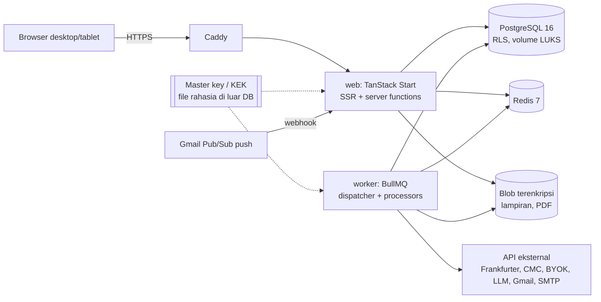
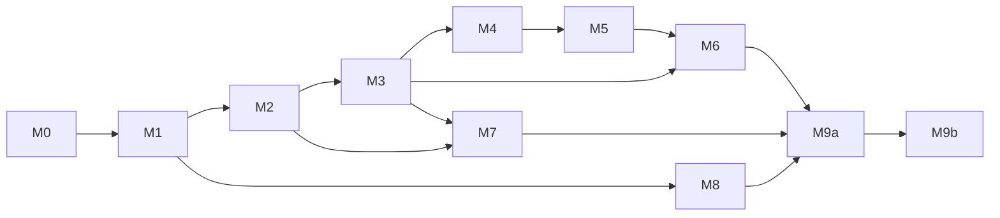

# write.financial — Rencana Implementasi (v1.1)

Pasangan dari `docs/PRD.md`. Nomor FR merujuk ke PRD, `[node]` ke desain Pencil, keputusan D1–D24 ke PRD §12. Riset sumber data pasar: `docs/research/market-data.md`.

Perubahan dari v1: proyek **open source (AGPL-3.0)** dengan dua mode deployment dari satu image (**self-host** default, **cloud** terkelola di write.financial), keamanan penyimpanan jadi syarat M0, **semua otomatisasi lewat konfirmasi**, data pasar **gratis + BYOK**, target **desktop + tablet** (mobile/PWA dihapus), subscriber = pelanggan hosting cloud, milestone M9 dipecah menjadi rilis open source dan rilis cloud.

---

## 1. Arsitektur



- **web** dan **worker** adalah dua proses dari satu monorepo. Worker tidak melayani HTTP. Web tidak menjalankan job berat, hanya enqueue.
- **Penjadwalan per user tidak memakai cron per user.** Satu *dispatcher* (tiap menit) memindai tabel yang `due_at <= now()` dengan `FOR UPDATE SKIP LOCKED` lalu meng-enqueue job dengan `jobId` deterministik. Beban sebanding jumlah item jatuh tempo, bukan jumlah user × cron.
- **Postgres adalah sumber kebenaran.** Redis hanya antrean, cache agregat, dan rate limit.
- **Konfirmasi adalah batas sistem (D14).** Worker tidak pernah memanggil fungsi yang membuat/mengubah transaksi atau anggaran. Worker hanya boleh membuat `review_items`, notifikasi, snapshot, harga, dan laporan. Ini dijaga secara struktural (§6) dan dengan tes.

## 2. Stack

| Lapisan | Pilihan | Catatan |
|---|---|---|
| Framework | TanStack Start (React 19, Vite) | `createServerFn` untuk RPC typed; SSR untuk first paint |
| Routing / data | TanStack Router + TanStack Query | Loader prefetch + invalidasi setelah mutasi |
| Form | TanStack Form + Zod | Skema Zod dibagi klien/server |
| Tabel | TanStack Table + TanStack Virtual | Buku kas ribuan baris, grup, subtotal |
| UI primitives | Radix UI via shadcn/ui (disalin ke repo) | Penamaan token desain sudah gaya shadcn |
| Styling | Tailwind CSS v4 (`@theme`) | Token Pencil di-generate ke CSS vars dark/light |
| Ikon / font | lucide-react, Geist + Geist Mono | Sesuai desain |
| Grafik | Recharts + `d3-sankey` + heatmap SVG kustom | Sankey 2 level di tablet (FR-TB2) |
| Command palette, DnD, toast | `cmdk`, `@dnd-kit`, `sonner` | — |
| Tanggal | `date-fns` + `@date-fns/tz` | Batas hari/periode per zona waktu user |
| ORM / migrasi | Drizzle ORM + drizzle-kit | `bigint` mode `bigint`; kebijakan RLS ditulis di migrasi SQL |
| Auth | Better Auth: Google, email/password, **plugin two-factor (TOTP + kode cadangan)**, **plugin passkey**, rate limit | Adapter Drizzle |
| Kripto | `node:crypto` AES-256-GCM (envelope), `@node-rs/argon2`, `age` untuk cadangan | Tanpa kripto buatan sendiri di luar wrapper tipis |
| Antrean | BullMQ (Redis `noeviction`) | `upsertJobScheduler` untuk dispatcher |
| PDF / Excel / CSV | Playwright-Chromium di worker; `exceljs`; `papaparse` + `xlsx` di browser | D4/D5 |
| LLM | Vercel AI SDK + provider OpenAI-compatible | OpenRouter/ZenMux/custom; tool calling hanya menghasilkan draft |
| Email | Nodemailer (SMTP) atau Resend | Abstraksi `Mailer` |
| Observability | pino (redaksi rahasia) + Bull Board (admin, 2FA) + GlitchTip opsional | Scrubber sebelum kirim error |
| Test | Vitest, Playwright, Testcontainers Postgres | — |

## 3. Struktur repo (pnpm workspaces + Turborepo)

```
apps/
  web/                 TanStack Start: routes/, components/, features/<modul>/
  worker/              entry, dispatcher, processors/<queue>.ts
packages/
  domain/              logika murni: money, fx, period, budget, valuation, recurrence, debt, goals, rules, receivables
  db/                  skema Drizzle, migrasi (+ RLS), repository ber-scope user, seed "Avtara"
  crypto/              envelope encryption (KEK/DEK), hashing, redaksi log
  jobs/                nama queue, payload Zod (hanya ID, tidak pernah rahasia), helper enqueue + jobId
  ui/                  token (generated), komponen shadcn, <Money/>, <Delta/>, <Percent/>, Rail
  integrations/        adapter: fx, market/<provider>, llm, gmail, mailer, blobstore
  entitlements/        plans + can(user, feature) (D17)
  config/              tsconfig, eslint (+ aturan lint kustom), env schema Zod
tools/tokens-from-pen/ baca variables file desain → packages/ui/src/tokens.css (hasilnya di-commit; file .pen privat, tidak ada di repo)
deploy/
  docker/              Dockerfile multi-stage (satu image: web | worker | migrate via argumen)
  compose/             docker-compose.yml self-host (app, worker, postgres, redis, caddy) + .env.example
  cloud/               konfigurasi instance write.financial (tanpa rahasia)
design/                digest (di git) + html export (di .gitignore)
docs/                  PRD, rencana, riset; docs/self-host/ (instalasi, upgrade, cadangan, Gmail, sumber data)
LICENSE (AGPL-3.0) · SECURITY.md · CONTRIBUTING.md · TRADEMARK.md
```

Aturan dependensi: `domain` tidak bergantung ke apa pun. Hanya `db` yang boleh membuka koneksi Postgres. Hanya `crypto` yang memegang KEK. `web` dan `worker` tidak mengimpor driver Postgres langsung (lint).

## 4. Model data (Drizzle / Postgres)

Konvensi: `id uuid v7`; `user_id uuid not null` di setiap tabel milik user dengan indeks komposit diawali `user_id`; `created_at/updated_at timestamptz`; soft delete `deleted_at` untuk entitas yang bisa di-undo. Uang `bigint` minor unit + `currency char(3)`, unit/harga `numeric(28,10)`, kurs `numeric(20,8)`. Kolom bersufiks `_enc` = `bytea` ciphertext AES-GCM (format: versi kunci ‖ nonce ‖ ciphertext ‖ tag), didekripsi hanya di `packages/crypto`.

### 4.0 Keamanan data (lintas tabel)
| Objek | Isi |
|---|---|
| Role DB | `wf_app` (tanpa superuser, tanpa `BYPASSRLS`), `wf_worker` (sama, plus akses tabel global harga/kurs), `wf_migrate` (DDL saja, hanya di CI/rilis), `wf_readonly_ops` (audit, tercatat). |
| RLS | `ALTER TABLE … ENABLE ROW LEVEL SECURITY; FORCE ROW LEVEL SECURITY;` + kebijakan `user_id = current_setting('app.user_id')::uuid` di setiap tabel milik user. Repository membuka transaksi lalu `SET LOCAL app.user_id = $sessionUserId`. Worker men-set `app.user_id` per job. Tabel global (`market_quotes`, `fx_rates` bawaan) tanpa `user_id` dan hanya-baca untuk `wf_app`. |
| `user_keys` | user_id, `dek_wrapped bytea`, `kek_version int`, created_at, rotated_at. Hapus baris = crypto-shredding semua kolom `_enc` dan blob user itu. |
| `security_events` | append-only (trigger menolak UPDATE/DELETE): type, ip_hash, user_agent, meta, at. |
| `plans`, `entitlements` | `plans(code, name)`, `user_plans(user_id, plan_code, since)`, `entitlements(plan_code, feature, limit)`. v1: semua user `pribadi`. |

### 4.1 Inti
| Tabel | Kolom kunci | Constraint / catatan |
|---|---|---|
| `users`, `sessions`, `accounts_auth`, `verifications`, `two_factors`, `passkeys` | dikelola Better Auth | + `nickname`, `timezone`, `locale`, `base_currency`, `onboarding_completed_at`, `deletion_requested_at`. Secret TOTP disimpan terenkripsi, kode cadangan di-hash |
| `user_preferences` | theme, number_format, date_format, week_start, hide_balances, period_start_day (1–28), period_mode, notif jsonb, dashboard_layout jsonb, table_prefs jsonb, cc_payment_priority jsonb | 1:1 user |
| `accounts` | type enum, provider_name, logo_key, display_name, last4, phone_masked, currency, opening_balance_minor, opening_date, color, include_in_available, show_as_card, is_default_quick_entry, sort_order, status, archived_at, low_balance_threshold_minor, last_reconciled_at, cc_limit_minor, cc_statement_day, cc_due_day, parent_account_id | partial unique `(user_id) where is_default_quick_entry` |
| `categories` | kind enum(expense, income, fee), group enum, name varchar(24), icon, color, sort_order, is_fixed, archived_at, deleted_at, is_system | unique `(user_id, kind, lower(name))` where not deleted; kategori sistem "Piutang tak tertagih", "Selisih kurs" |
| `tags`, `tag_aliases`, `transaction_tags` | slug, usage cache | maks. 5 tag per transaksi |
| `transactions` | type enum(expense, income, transfer, dividend, adjustment, investment, receivable_out, receivable_in, writeoff), occurred_at, local_date, period_id, description, merchant, `note_enc`, category_id, source enum(manual, quick, assistant, receipt, import, gmail, recurring, period_close), recurrence_id, split_parent_id, duplicated_from_id, import_batch_id, external_hash, goal_id, paid_from_goal_id, receivable_id, client_id, confirmed_by_user_at, deleted_at | unique `(user_id, client_id)`; unique `(user_id, import_batch_id, external_hash)`; **check `confirmed_by_user_at is not null`**: hanya transaksi terkonfirmasi yang ada di tabel ini; kandidat berada di `review_items` |
| `postings` | transaction_id, account_id, amount_minor (±), currency, fx_rate_to_base, amount_base_minor, role enum(principal, fee, fx_diff, tax) | Saldo = opening + Σ postings dari transaksi yang tidak dihapus. Transfer: 2 posting |
| `transfer_meta` | transaction_id, sent/received minor+currency, reference_rate, rate_source, rate_as_of | — |
| `attachments` | transaction_id, blob_key, mime, size, kind, `ocr_enc` | Blob dienkripsi dengan DEK user sebelum ditulis ke disk |
| `balance_adjustments`, `activity_log` | — | `activity_log` per entitas untuk timeline |

### 4.2 Periode, anggaran
| Tabel | Kolom kunci | Catatan |
|---|---|---|
| `periods` | label, start_date, end_date, days, kind enum(normal, transition), status enum(open, closed), closed_at | unique `(user_id, start_date)` |
| `budget_versions`, `budget_lines` | effective_from, expected_income_minor; category_id, limit_minor, rollover, is_fixed, alert_pct | Versi berlaku sampai diganti |
| `budget_period_overrides` | period_id, category_id, delta_minor, reason enum(transfer, rollover, proration), review_item_id | Rollover/transfer sisa dari tutup buku hanya dibuat saat review dikonfirmasi |
| `budget_alert_dismissals` | period_id, category_id | — |

### 4.3 Jadwal, review, langganan, notifikasi
| Tabel | Kolom kunci | Catatan |
|---|---|---|
| `recurrences` | template jsonb, freq, interval, weekday, month_day, end_type, end_count, remind_offset_days, status, stopped_at | `requires_review` dihapus: selalu review (D14) |
| `subscriptions` | name, plan, logo_key, price_minor, currency, cycle, next_billing_date, pay_from_account_id, category_id, remind_days_before, trial_ends_on, status, paused_until, cancel_mode, ends_on, usage_rating, next_review_on | — |
| `scheduled_occurrences` | source_type enum(recurrence, subscription, goal_plan, installment, cc_statement, receivable), source_id, due_date, expected_minor, currency, status enum(scheduled, due_review, confirmed, skipped, unconfirmed), transaction_id, remind_at, reminded_at | **unique `(source_type, source_id, due_date)`**; dimaterialisasi 90 hari ke depan |
| `review_items` | reason enum(ai_suggestion, category_deleted, due_occurrence, import_row, period_close_proposal), source enum(gmail, assistant, receipt, schedule, period_close, system), payload `_enc` jsonb (draft transaksi/usulan), ai_confidence, status enum(pending, confirmed, ignored), resolved_at, resulting_transaction_id | Satu antrean (FR-L7). Konfirmasi = satu server function `confirmReview` yang membuat transaksi dalam satu DB transaction |
| `detected_recurring` | merchant_key, day_of_month, amount_minor, occurrences, status | — |
| `notifications` | type, category, title, body, action jsonb, ref, read_at, created_at | Retensi 90 hari (FR-S5) |
| `notification_outbox` | channel enum(email), payload, send_at, sent_at, attempts | Nominal di email mengikuti mode privasi user |

### 4.4 Tabungan, utang, piutang
| Tabel | Kolom kunci | Catatan |
|---|---|---|
| `goals`, `goal_funding_sources`, `goal_contribution_plans` | (seperti v1) | Σ pct per aset ≤ 100 |
| `debts`, `installments`, `debt_allocations` | (seperti v1) | — |
| `receivables` | `counterparty_enc`, principal_minor, currency, from_account_id, source enum(split_bill, loan), source_transaction_id, due_date, remind, status enum(open, partial, settled, written_off), `note_enc` | FR-U7 |
| `receivable_payments` | receivable_id, transaction_id, amount_minor, received_at | Σ pembayaran ≤ principal; sisa = principal − Σ |

### 4.5 Investasi & data pasar
| Tabel | Kolom kunci | Catatan |
|---|---|---|
| `assets` | account_id, symbol, name, quote_currency, asset_class, category_id, price_mode enum(server, byok, manual, computed), manual_price, manual_price_at, premium_pct (emas Antam), meta jsonb (kupon ORI, jadwal dividen) | — |
| `asset_categories`, `allocation_targets`, `investment_trades`, `holdings` | (seperti v1) | — |
| `market_quotes` (global) | provider, symbol, quote_ccy, bucket_ts, price, prev_close, fetched_at | **Hanya dari sumber bawaan** (Frankfurter, fawazahmed0, CMC Basic). PK `(provider, symbol, bucket_ts)` |
| `user_quotes` (per user) | user_id, provider, symbol, bucket_ts, price, prev_close, fetched_at | Hasil BYOK; RLS; **dihapus saat key provider dihapus** |
| `fx_rates` | base, quote, rate, provider, rate_type (transaksi BI/blended), as_of, user_id nullable | Manual = per user |
| `market_credentials` | user_id, provider, `api_key_enc`, last4, status, quota_used, quota_limit, quota_reset_at, last_tested_at | Butuh 2FA aktif untuk insert |
| `market_api_logs` | user_id nullable, provider, endpoint (key dimasking), status, duration_ms, retry, at | Retensi 30 hari |
| `portfolio_snapshots`, `networth_snapshots` | date, value_minor, cost_minor, contributions_minor, breakdown jsonb | Harian + akhir bulan |

### 4.6 Laporan, AI, integrasi, sistem
`reports` (immutable setelah final) · `report_files` (blob terenkripsi) · `auto_rules` · `ai_provider_configs` (`api_key_enc`, last4, model, permissions, monthly_limit_usd) · `ai_usage_logs` (tanpa isi prompt) · `gmail_connections` (`tokens_enc`, history_id, watch_expires_at, status, filters jsonb) · `email_ingest_logs` (message_id unik, from, subject, `quote_enc`, filter_result, `extraction_enc`, confidence, outcome enum(pending, confirmed, ignored, duplicate, filtered), review_item_id; retensi 30 hari) · `import_batches` · `drafts` (`payload_enc`) · `backups` · `recent_items` · `job_status`.

Indeks pencarian: `pg_trgm` GIN pada `transactions(merchant, description)`, `subscriptions(name)`, `goals(name)`, `assets(symbol, name)`. Catatan terenkripsi tidak bisa dicari di SQL; pencarian catatan berjalan di server setelah dekripsi pada hasil yang sudah difilter rentang tanggal (FR-L2 tetap terpenuhi untuk volume per user).

## 5. Paket `domain` (golden test dari seed desain)

| Modul | Fungsi utama | Golden test |
|---|---|---|
| `money` | parse ("25rb", "1,5jt"), format (table/headline/sentence/delta/privacy), minor↔major, U+2212 | `42.810.000`; `−2.277.000` |
| `fx` | convert, kurs efektif, selisih kurs, deviasi manual | US$183,49; 16.474; −22.660 |
| `period` | periodFor, label, transisi + prorata, pemetaan hitung ulang | "Oktober" = 25 Sep–24 Okt; 15.000.000 |
| `budget` | pct, ideal, batas aman harian (floor Rp1.000), proyeksi (D8), akan lewat, mingguan, usulan tutup buku | 88%, 48%, Rp140.000 |
| `ledger` | balanceOf, availableBalance, netWorth (termasuk piutang, dikurangi utang) | 55.023.000; 116.443.000 (+ piutang 542.500 di skenario Section 19) |
| `valuation` | nilai holding, biaya rata-rata, P/L, drift, rebalance, resolusi harga (manual-lock → BYOK → server → terakhir) | SPY ≈ Rp13.500.000; drift 3,1% |
| `goals` | progres, resolusi sumber dana, setoran/bulan, ETA, bulan dana darurat | 21%; 2.250.000 |
| `recurrence` | nextOccurrences, kondisi akhir | 14 Nov, 14 Des, 14 Jan |
| `debt` | split 0%, anuitas, alokasi prioritas, rekalkulasi, sisa limit | 333.334/333.333/333.333; 13.000.000 |
| `receivables` | sisa, status, efek ke kekayaan bersih, hapuskan → expense | Raka 400.000 − 100.000 − 200.000 = 100.000 (75%) |
| `subscriptions` | total bulanan/tahunan, sisa bulan ini, hemat | 904.900; 11.520.000; 660.900 |
| `rules` | evaluate → {category, tags, reasons} (hanya saran) | teratas menang; tag gabungan |
| `report` | buildMonthlyReport | Sep: 25,8 / 18,3 / 29,1% |

## 6. Worker: antrean & jadwal

**Aturan struktural (D14):** processor worker menerima objek `WorkerDb` yang hanya mengekspos repository untuk `review_items`, `scheduled_occurrences`, `notifications`, `notification_outbox`, `market_quotes`, `user_quotes`, `fx_rates`, `snapshots`, `reports`, `periods.lock`, `job_status`, dan log. Repository transaksi, posting, anggaran, dan goal **tidak tersedia** di worker (dicek di tipe dan oleh tes arsitektur yang memindai impor).

| Queue | Pemicu | Job | Idempotensi (`jobId`) |
|---|---|---|---|
| `dispatch` | tiap 1 menit | Scan item jatuh tempo → enqueue | — |
| `occurrences` | harian per tz user 00.05 | Materialisasi 90 hari; `scheduled → due_review` (membuat `review_items`); `unconfirmed` bila lewat | `occ:{source}:{id}:{date}` |
| `reminders` | `remind_at <= now` | Pengingat H-N tagihan, cicilan, kartu kredit, trial, jeda, **piutang jatuh tempo** | `rem:{occurrenceId}` |
| `budget-alerts` | event setelah transaksi dikonfirmasi + harian 09.00 | Ambang 50/80/85/100% sekali per periode per ambang | `bud:{period}:{cat}:{pct}` |
| `balance-checks` | harian 07.00 | Saldo rendah, rekening > 14 hari belum dicek, saldo pembayar kurang | `bal:{user}:{date}` |
| `period-close` | saat `end_date` lewat | Kunci periode, hitung hasil, buat periode baru, susun laporan; **usulan** rollover/pindah sisa → `review_items` | `close:{periodId}` |
| `reports` | setelah close / manual | Snapshot → PDF/XLSX → blob terenkripsi → email bila opt-in | `rep:{periodId}:{format}` |
| `fx` | 17.00 WIB + retry 08.00 + manual | Frankfurter (provider BI) → fawazahmed0 → open.er-api | `fx:{date}` |
| `market-server` | kripto tiap 5 menit, emas spot harian | CMC Basic 1 call untuk union simbol (≤100 aset = 1 kredit), fawazahmed0 XAU; pantau `credit_count` | `mks:{provider}:{bucket}` |
| `market-byok` | per user aktif (≤ N hari), jam bursa: AS 15 menit, IDX penutupan + 10.00/12.00/14.30 WIB | Dekripsi key → panggil provider → `user_quotes`; 429/kuota habis → jeda sampai reset + fallback; lewati hari libur | `mkb:{user}:{provider}:{bucket}` |
| `market-test` | tombol "Tes koneksi" (rate limit 5/jam/provider) | Endpoint ringan per provider (lihat riset §3) → hasil per simbol | `mkt-test:{user}:{provider}:{requestId}` |
| `snapshots` | harian 23.55 tz user | Portofolio + kekayaan bersih | `snap:{user}:{date}` |
| `weekly-summary` | Senin 07.00 tz user | Ringkasan minggu lalu | `wk:{user}:{isoWeek}` |
| `notify` | outbox | Email dengan retry | `ntf:{outboxId}` |
| `detect-recurring` | harian | Kandidat langganan → saran (bukan langganan otomatis) | `det:{user}:{date}` |
| `ocr` | upload struk | LLM vision → `review_items` / isi form draft | `ocr:{attachmentId}` |
| `gmail` | webhook + polling 10 menit + renew watch 6 hari | Filter → ekstrak → aturan (saran) → **selalu `review_items`**; dedupe manual; log | `gm:{messageId}` |
| `rules-backfill`, `recalc-period`, `tag-merge` | aksi user | `rules-backfill` hanya menyusun daftar perubahan untuk dikonfirmasi; `recalc-period` dan `tag-merge` dijalankan setelah konfirmasi user (lewat server function di web) | `{kind}:{requestId}` |
| `backup` | 03.00 WIB | `pg_dump` → `age` encrypt → lokal + off-site; retensi 30 | `bk:{date}` |
| `account-deletion` | 7 hari setelah permintaan | Hapus data user + DEK (crypto-shredding) + blob | `del:{user}` |
| `maintenance` | harian | Purge soft-delete > 30 hari, notifikasi > 90 hari, log > 30 hari, token kedaluwarsa | `mt:{date}` |

Prinsip worker: processor transaksional; retry 5× eksponensial; payload job hanya berisi ID (tidak pernah rahasia atau data keuangan); status yang terlihat user di `job_status`.

## 7. Arsitektur frontend

- **Routes:** `/_auth/masuk|daftar|lupa|2fa`, `/onboarding/$step`, `/_app/` (Ringkasan), `/transaksi`, `/tinjau` (Perlu ditinjau), `/anggaran`, `/langganan`, `/kalender`, `/investasi`, `/laporan/$periode?`, `/tabungan`, `/utang` (`?tab=piutang`), `/notifikasi`, `/pengaturan/$section`, `/print/report/$id`. Search params Zod (`?period=2026-10`, `?range=2026-09-14..2026-10-13`).
- **Layout responsif (FR-TB):** `≥1280` sidebar penuh; `768–1279` `<Rail>` 64 px + tooltip; panel detail jadi `<Sheet>` di `<1280`; kartu dashboard memakai grid yang menurunkan kolom; `<768` halaman "Gunakan tablet atau desktop" + tombol Catat. Breakpoint diuji di 1440, 1024, 768.
- **Global overlays** di layout `_app`: Catat sheet, ⌘K, Asisten ⌘J, Notifikasi, Pengaturan ⌘,.
- **Komponen fondasi (M0):** `<Money>` (konteks + privasi + tanda), `<Delta>`, `<Percent>`, `<DateLabel>`, `<PageState>`, `<KbdHint>`, `<UndoToast>`, `<ConfirmDialog impact>`, `<SecretInput>` (tidak pernah menerima nilai lama dari server), `<CodeInput>` 6 digit, `<RangePicker>`. Lint: tidak ada angka uang tanpa `<Money>`; tidak ada `dangerouslySetInnerHTML`.
- **Token:** `tools/tokens-from-pen` → `tokens.css` + `@theme`. Token yang tidak ada (`$violet-fg`, `$cyan-fg`, `$yellow-fg`) **tidak** dibuat; pakai `$violet`, `$cyan`, `$yellow`.
- **Keyboard:** registry shortcut tunggal; tetap aktif untuk keyboard eksternal di tablet.

## 8. Milestone

Setiap milestone bisa di-deploy ke staging dan didemokan. **Exit** wajib lulus.

### M0 — Fondasi aman
- Monorepo, CI (typecheck, lint + aturan kustom, Vitest, Playwright smoke, pemindaian dependensi & rahasia), env schema.
- Drizzle + migrasi awal **dengan RLS + role DB terpisah**; repository ber-scope user; `packages/crypto` (KEK dari file rahasia, DEK per user, redaksi log).
- Better Auth: Google + email/password, Argon2id, cek kata sandi bocor, lockout/rate limit, **2FA TOTP + kode cadangan + passkey**, daftar perangkat, `security_events` (FR-A1–A3, A5, A8, A10).
- Token, tema, font, app shell **desktop + rail tablet**, komponen fondasi §7, `<Money>` + mode privasi.
- `domain`: `money`, `period`, `ledger` + golden tests. Worker skeleton (dispatcher, Bull Board di balik admin + 2FA, `maintenance`).
- **Distribusi sejak awal:** satu image Docker (`web`/`worker`/`migrate`), `docker-compose.yml` self-host, `.env.example`, entrypoint yang membuat KEK otomatis bila belum ada (dan meminta pengguna mencadangkannya), migrasi otomatis saat start, wizard setup pertama (FR-OP1), mode `DEPLOYMENT_MODE` (D22).
- Repo publik: `LICENSE` AGPL-3.0-only (sudah ada), header `SPDX-License-Identifier: AGPL-3.0-only` di setiap file sumber (dicek lint), SECURITY.md, CONTRIBUTING.md dengan **DCO** (`git commit -s`, dicek CI), TRADEMARK.md, pemindaian rahasia (CI + pre-commit), rilis image ke GHCR dengan SBOM.
- Staging cloud: Caddy (TLS, HSTS, CSP), volume terenkripsi, cadangan `age` + off-site.

**Exit:** di mesin kosong, `docker compose up` → wizard setup → login admin + 2FA dalam ≤ 15 menit (G5); **tes isolasi tenant** (user B tidak bisa membaca data A, baik lewat API maupun query langsung tanpa `app.user_id`); dump DB tidak mengandung rahasia plaintext; restore cadangan terenkripsi teruji; golden tests lulus; CI menolak commit berisi rahasia.

### M1 — Buku kas
- Onboarding 5 langkah (FR-A4); rekening + rekonsiliasi (FR-R1–R6); kategori + tag (FR-K1–K3).
- Catat sheet + bar Catat Cepat (FR-T1–T4, T8, T9); halaman Transaksi (FR-L1–L6) termasuk sheet detail di tablet.
- ⌘K v1.

**Exit:** 128 transaksi seed → saldo tersedia **Rp55.023.000**; transfer IDR→USD selisih −Rp22.660; hapus → Urungkan; keyboard-only; layout lulus di 1440/1024/768.

### M2 — Periode, anggaran, dashboard
- Periode + transisi + hitung ulang (FR-P1–P3); anggaran (FR-B1–B5); Dashboard Minggu/Bulan/Tahun + **rentang khusus** (FR-D1, D2, D4, FR-S7); Sankey 2 level di tablet.

**Exit:** 88% / 48% / Rp140.000 / 87% / 90% / 36,5%; transisi 1–24 Nov = Rp15.000.000; September read-only; rentang 14 Sep–13 Okt menampilkan "30 hari · melintasi 2 periode".

### M3 — Jadwal, Perlu ditinjau, langganan, kalender, notifikasi
- Recurrence (FR-T6, L8); `scheduled_occurrences` + worker; **halaman `/tinjau`** dengan semua alasan (FR-L7) + `confirmReview`; tutup buku otomatis + usulan (FR-P4).
- Langganan (FR-SUB1–SUB6); Kalender (FR-C1–C3); notifikasi popover + **halaman** + email (FR-S5, FR-ST3).

**Exit:** Netflix tgl 18 → pengingat H-1 09.00 WIB tepat sekali → `/tinjau` pada due date → saldo berubah hanya setelah "Sudah dibayar"; **tes arsitektur: worker tidak bisa mengimpor repository transaksi/anggaran**; tutup buku September menghasilkan usulan "pindah sisa Rp1.150.000 ke Dana Darurat" yang tidak berlaku sebelum dikonfirmasi; restart worker tidak menduplikasi.

### M4 — Tabungan, utang, kartu kredit, piutang
- Tujuan + dana tidak rutin (FR-G1, G3, G4, FR-B6); kartu kredit + cicilan (FR-R7, FR-U1–U6); **piutang** lengkap: daftar, catat, terima sebagian/lunas, hapuskan, pengingat, dari pisah tagihan (FR-U7, FR-L5).

**Exit:** skenario Section 18 (333.334/333.333/333.333, sisa limit 13.000.000); skenario Section 19: piutang Rp542.500 → catat Bima Rp500.000 → 1.042.500, saldo BCA 42.310.000, pengeluaran Oktober tetap Rp16.500.000; terima Raka Rp200.000 → sisa 100.000 (75%), pemasukan Oktober tetap.

### M5 — Investasi & data pasar
- Aset, trade, holdings (FR-I1, I2, I4); valuasi + grafik + drift + rebalancing (FR-I3); alokasi aset ke tujuan (FR-G2, G5, G6).
- Data pasar sesuai FR-I6: adapter Frankfurter/fawazahmed0/open.er-api, CMC Basic (key operator), BYOK Tiingo/Finnhub/Massive/Alpha Vantage/EODHD/Marketstack/CoinGecko/CMC/GoldAPI/metals.dev, manual + estimasi (Antam premium, RDPU akrual, ORI kupon). Layar API kurs & pasar (FR-ST4) dengan tes koneksi, meter kuota, lisensi, 2FA wajib.

**Exit:** seed: Rp61.420.000 / +Rp7.489.000 / drift 3,1%; **hasil BYOK user A tidak pernah terbaca oleh user B** (tes); hapus key → `user_quotes` provider itu terhapus; semua provider dimatikan → halaman tetap tampil dengan sumber + cap waktu; 429 menjeda sampai `retry-after`; tidak ada request ke domain yang dilarang (allowlist egress di adapter).

### M6 — Laporan, ekspor, impor, data user
- Laporan + Kuartal/Tahunan/Kustom (FR-LP1, LP2, LP5); PDF/Excel + email opt-in (FR-LP3, LP4, FR-L10); impor CSV/XLSX → review (FR-L9); ekspor semua data + hapus akun (FR-ST5, FR-A11).

**Exit:** laporan September seed (25,8 / 18,3 / +7,5 jt / 29,1% / Rp112.200.000); PDF 4 halaman; impor contoh BCA 41/5/2; hapus akun → setelah 7 hari data + DEK hilang, blob tidak bisa didekripsi.

### M7 — Otomasi & AI
- Aturan (saran) + backfill dengan konfirmasi (FR-AI1); BYOK AI + log + batas biaya (FR-AI2); Asisten ⌘J draft → konfirmasi (FR-AI3); OCR struk (FR-T7); **Gmail di feature flag**: semua → `/tinjau`, Log Gmail, uji filter, pemutusan izin (FR-AI4).

**Exit:** chat "45.000 GoPay" → draft 93% / Rp367.000 → konfirmasi → `source=assistant`; tes negatif: tanpa klik konfirmasi tidak ada baris di `transactions`; email PLN 97% → **review item**, bukan transaksi; webhook ganda → satu review item.

### M8 — Tablet, kustomisasi, kualitas
- Penyempurnaan tablet seluruh halaman (FR-TB1–TB4), target sentuh, tekan-lama; Atur dashboard (FR-D3); PIN kunci aplikasi per perangkat (FR-A6).
- Audit aksesibilitas (axe + keyboard), kontras token, performa p95.

**Exit:** semua halaman utama lulus visual review di 1440/1024/768 dibandingkan Section 19; axe 0 pelanggaran serius; p95 TTFB < 300 ms dengan 10.000 transaksi.

### M9a — Rilis open source v1.0
- Panduan self-host lengkap (`docs/self-host/`): kebutuhan server, instalasi, reverse proxy, SMTP, Google OAuth + Gmail dengan project milik sendiri (D24), key sumber data (D23), cadangan & restore, rotasi KEK, upgrade antar versi.
- Halaman admin & status instance (FR-OP2–OP5), migrasi naik versi yang diuji dari rilis sebelumnya, catatan rilis + semver.
- Atribusi sumber data (Frankfurter/BI, "Rates By Exchange Rate API" bila dipakai, "Powered by CoinGecko" bila BYOK CoinGecko aktif) dan catatan merek pihak ketiga untuk logo bank/e-wallet.
- Audit keamanan kode (review + pemindaian otomatis) dan kebijakan pengungkapan kerentanan aktif.

**Exit:** instalasi bersih dan upgrade dari rilis sebelumnya lulus otomatis di CI (compose); panduan diuji oleh orang yang bukan penulisnya; temuan kritis/tinggi = 0.

### M9b — Peluncuran cloud write.financial
- Badan usaha (PT Perorangan + NIB) dan pendaftaran PSE Lingkup Privat [perlu konfirmasi konsultan] (D19); kebijakan privasi + syarat layanan cloud (UU PDP), prosedur insiden.
- Uji penetrasi eksternal instance cloud (OWASP ASVS L2 untuk auth/sesi/kripto).
- Fitur khusus cloud: pendaftaran terbuka, paket hosting & kuota sumber daya, alur pindah ke self-host (FR-OP6). Billing bisa menyusul setelah peluncuran.
- Google OAuth verification (login). Gmail di cloud tetap off sampai verifikasi restricted scope + penilaian keamanan pihak ketiga selesai.
- Runbook: rotasi KEK, restore, revoke sesi massal, pemantauan kuota CMC operator.

**Exit:** dokumen legal terbit; temuan uji penetrasi kritis/tinggi = 0; drill restore + rotasi KEK sukses; pindah data cloud → self-host → cloud tanpa selisih (G6).



## 9. Strategi pengujian

- **Domain (Vitest):** golden test dari seed + Section 19; property test `money`, `period`, `debt`, `receivables` (Σ pembayaran ≤ pokok).
- **Server (Vitest + Testcontainers):** tes isolasi tenant generik atas semua server functions **dan** query mentah tanpa `app.user_id` (harus 0 baris); tes 2FA wajib untuk aksi sensitif (FR-A9); tes bahwa respons API tidak pernah memuat field `_enc` atau key utuh.
- **Worker:** fake clock; idempotensi (2×); crash di tengah; zona waktu WIB/WITA/WIT; **tes arsitektur D14** (impor terlarang) + tes perilaku (tidak ada baris `transactions` baru setelah menjalankan semua processor).
- **Keamanan:** pemindaian dependensi dan rahasia di CI; tes header (CSP, HSTS, frame); fuzz upload (MIME palsu, ukuran); log scrubber (pola key/token/nomor kartu tidak pernah tercetak).
- **E2E (Playwright):** exit criteria tiap milestone di viewport 1440/1024/768; keyboard-only; mode privasi (regex nominal tidak terlihat).
- **Visual:** dibandingkan dengan export PNG Pencil per milestone (review manual).

## 10. Deploy di VPS

- **Self-host (resmi):** `docker compose up -d` dari `deploy/compose/`: `app` (web), `worker`, `postgres`, `redis`, `caddy` (TLS otomatis). Data di volume bernama; panduan menyarankan disk terenkripsi dan cadangan off-site. Pengelola yang sudah punya Postgres/Redis bisa menunjuk ke sana lewat `.env`.
- **Cloud write.financial:** image yang sama. Di VPS saat ini memakai Postgres/Redis yang sudah ada; `web` (2 instance) + `worker` sebagai container (atau PM2 untuk build non-container), Caddy di depan. Postgres/Redis hanya listen di `127.0.0.1`/jaringan privat.
- **Penyimpanan:** data Postgres, Redis AOF, dan direktori blob di volume **LUKS**. Swap dinonaktifkan atau terenkripsi.
- **Rahasia:** KEK di file `0400` milik user service (di luar repo dan luar `.env` yang dibaca proses lain), dimuat sekali saat start; `.env` `0600`. Rotasi KEK = re-wrap `user_keys.dek_wrapped`, versi kunci disimpan di ciphertext.
- **Postgres:** role terpisah (§4.0), `pg_trgm`, `log_statement` tanpa parameter, `pg_dump` harian → `age` → off-site (rclone S3/Backblaze), uji restore bulanan.
- **Redis:** `noeviction`, AOF `everysec`, `requirepass`, DB index terpisah untuk antrean & cache; payload job tanpa rahasia.
- **Jaringan:** firewall 80/443 + SSH (kunci saja, non-root), fail2ban, update keamanan otomatis; egress worker ke API eksternal lewat allowlist domain di adapter.
- **Rilis:** CI build → artefak → `drizzle-kit migrate` (role migrate) → reload `web` → restart `worker` graceful.
- **Monitoring:** health web + heartbeat worker, alert dispatcher > 5 menit, kuota CMC operator ≥ 80%, lonjakan login gagal, Bull Board di balik admin + 2FA.

## 11. Risiko teknis

| Risiko | Dampak | Mitigasi |
|---|---|---|
| RLS lupa diaktifkan di tabel baru | Kebocoran antar user | Tes migrasi: setiap tabel dengan `user_id` wajib punya kebijakan RLS + `FORCE` |
| Kehilangan KEK | Semua rahasia & catatan tak terbaca | KEK dicadangkan offline di 2 lokasi; drill rotasi/restore di M9 |
| Pencarian catatan terenkripsi lebih lambat | UX cari | Filter rentang tanggal di SQL dulu, dekripsi hanya hasilnya; metadata (merchant) tetap terindeks |
| Free tier/ToS penyedia berubah | Harga basi/ilegal | Adapter + fallback + manual; tinjau ToS tiap rilis; allowlist egress |
| Kuota CMC operator habis saat user bertambah | Kripto basi | 1 call per bucket untuk union simbol; alarm 80%; fallback cache + BYOK user |
| Gmail restricted scope | Gmail tidak bisa publik | Feature flag; dibuka setelah verifikasi M9 |
| Ledger + review queue menambah kompleksitas | Kecepatan M1/M3 | Helper domain `createExpense/createTransfer/confirmReview` |
| PDF Chromium berat | Memori VPS | Concurrency 1 untuk `reports` |
| Layout tablet tidak diuji | Regresi | Playwright di 3 viewport sejak M1 |

## 12. Langkah berikutnya

1. Simpan `dompetku.pen` di aplikasi Pencil (⌘S): Section 19–20 dan perubahan nama masih di memori aplikasi.
2. Buat repo publik (mis. `github.com/<akun>/write.financial`) dengan `LICENSE` yang sudah ada, SECURITY.md, dan pemindaian rahasia aktif sebelum commit pertama berisi kode.
3. Siapkan domain `write.financial`: DNS, SPF/DKIM/DMARC untuk `no-reply@write.financial` (D18). Badan usaha + PSE baru dibutuhkan menjelang M9b.
4. Mulai M0: scaffold monorepo + image Docker + compose self-host, RLS + `packages/crypto`, auth + 2FA, wizard setup, token dari `dompetku.pen`, `<Money>`, golden test domain.
