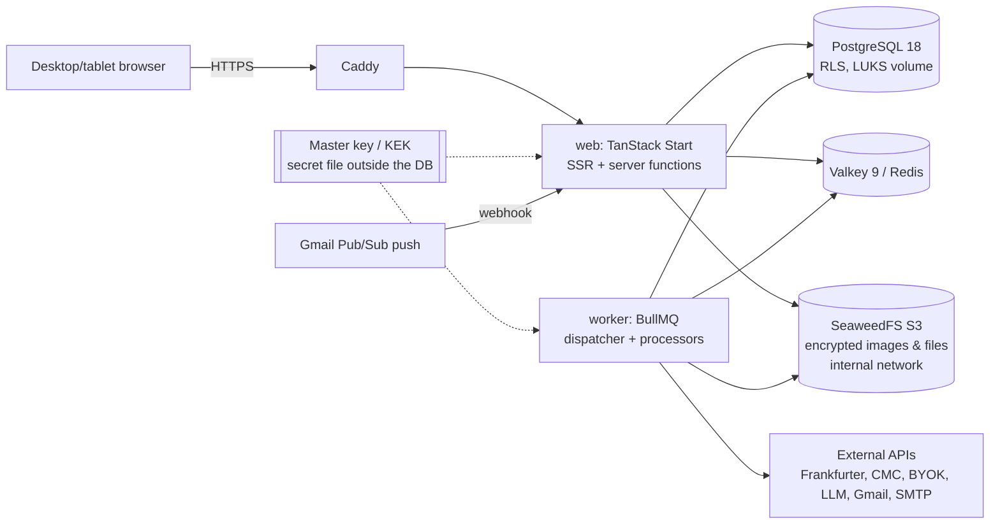
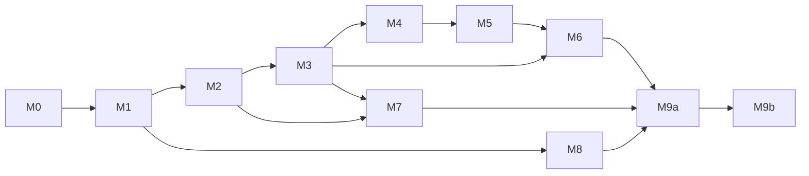

# write.financial — Implementation Plan (v1.1)

Companion to `docs/PRD.md`. FR numbers refer to the PRD, `[node]` to the Pencil design, decisions D1–D26 to PRD §12. Market data source research: `docs/research/market-data.md`.

Changes from v1: the project is **open source (AGPL-3.0)** with two deployment modes from a single image (**self-host** by default, managed **cloud** at write.financial); storage security becomes an M0 requirement; **all automation goes through confirmation**; market data is **free + BYOK**; target is **desktop + tablet** (mobile/PWA removed); subscriber = cloud hosting customer; milestone M9 is split into an open source release and a cloud release.

---

## 1. Architecture



- **web** and **worker** are two processes from one monorepo. The worker does not serve HTTP. The web process does not run heavy jobs; it only enqueues.
- **Per-user scheduling does not use per-user cron.** A single *dispatcher* (every minute) scans tables for `due_at <= now()` with `FOR UPDATE SKIP LOCKED` and enqueues jobs with a deterministic `jobId`. Load scales with the number of due items, not users × crons.
- **Postgres is the source of truth.** Redis is only the queue, aggregate cache, and rate limiter.
- **Confirmation is a system boundary (D14).** The worker never calls functions that create/modify transactions or budgets. The worker may only create `review_items`, notifications, snapshots, prices, and reports. This is enforced structurally (§6) and by tests.

## 2. Stack

Versions checked against the npm registry, nodejs.org, and Docker Hub on 18 Oct 2026. Exact versions are pinned in the lockfile/compose at M0; Renovate/Dependabot keeps them current.

| Layer | Choice (version) | Notes |
|---|---|---|
| Runtime | **Node.js 24 LTS** (24.22) | Active LTS. Node 22 is already in maintenance; Node 26 becomes LTS later this month and is adopted after its first LTS patch. Image: `node:24-bookworm-slim` |
| Package manager / monorepo | **pnpm 12** (12.14), Turborepo 2.11 | Pinned via `packageManager`; installed with `npm i -g pnpm@12` (Corepack is no longer bundled from Node 25) |
| Language | **TypeScript 6.0** (6.0.3) | TS 7.0 (native Go compiler) is released, but `typescript-eslint` 8.71 only supports TS < 6.1, so type-aware linting would break. Move to 7.x once typescript-eslint supports it |
| Framework | TanStack Start 1.169 (React 19.3, **Vite 8**) | Start requires Vite ≥ 8; `createServerFn` for typed RPC; SSR for first paint |
| Routing / data | TanStack Router 1.170 + TanStack Query 5.104 | Loader prefetch + invalidation after mutations |
| Form | TanStack Form 1.33 + **Zod 4** (4.6) | Zod schemas shared client/server |
| Table | **TanStack Table 9** (9.3) + TanStack Virtual 3.14 | v9 is the current major; ledger with thousands of rows, groups, subtotals |
| UI primitives | shadcn CLI 4 + `radix-ui` 1.8 (unified package) | Components copied into the repo; design token naming is already shadcn-style |
| Styling | Tailwind CSS 4.3 (`@theme`) | Pencil tokens generated into dark/light CSS vars |
| Icons / font | lucide-react 1.59, `geist` 1.8 | Per the design |
| Charts | **Recharts 3** (3.10) + `d3-sankey` 0.12 + custom SVG heatmap | `d3-sankey` is unchanged since 2022 but it is a small, stable layout library |
| Command palette, DnD, toast | `cmdk` 1.1, `@dnd-kit/core` 6.3 + `@dnd-kit/sortable` 10, `sonner` 2 | dnd-kit's stable line has had no release since Dec 2024; its successor `@dnd-kit/react` is still 0.x. Kept for built-in keyboard sorting and screen-reader announcements; switch to `@dnd-kit/react` at 1.0 |
| Dates | `date-fns` 4.4 + `@date-fns/tz` 1.5 | Day/period boundaries per user time zone |
| Database | **PostgreSQL 18** (18.6) | Native `uuidv7()` (no extension needed for UUID v7 IDs), RLS, `pg_trgm`. Driver `postgres` (postgres.js) 3.4 |
| ORM / migrations | Drizzle ORM 0.45 + drizzle-kit 0.31 (stable) | 1.0 is at RC (rc.5). Stay on stable; Better Auth already supports both, so upgrade at 1.0 GA. RLS policies in SQL migrations |
| Auth | Better Auth 1.7: Google, email/password, **two-factor plugin**, **`@better-auth/passkey`**, rate limit | Drizzle adapter |
| Crypto | `node:crypto` AES-256-GCM (envelope), `@node-rs/argon2` 2.2, `age` for backups | No home-grown crypto beyond a thin wrapper |
| Queue / cache | **BullMQ 6** (6.3) + ioredis 6 on **Valkey 9** (9.2) | Valkey is BSD-licensed and drop-in for Redis; the self-host compose ships Valkey. Any Redis ≥ 7 / Valkey works (the existing VPS Redis is fine if it can use `noeviction`) |
| PDF / Excel / CSV | Playwright 1.64 Chromium in the worker; **SheetJS CE 0.20.3** (from `cdn.sheetjs.com`, not npm) for XLSX read + write; `papaparse` 5.7 for CSV | The npm `xlsx` package is stuck at 0.18.5 with known advisories (GHSA-4r6h-8v6p-xvw6, GHSA-5pgg-2g8v-p4x9). `exceljs` dropped: no release since Dec 2024 |
| LLM | Vercel **AI SDK 7** (7.0) + OpenAI-compatible provider | OpenRouter/ZenMux/custom; tool calling only produces drafts |
| Email | Nodemailer 10 (SMTP) or Resend 6; templates with React Email 1.0 | `Mailer` abstraction; templates rendered per user locale |
| i18n | **Paraglide JS 2** (2.29) + inlang message format; `Intl.*` APIs | D26; locales `id` (source) + `en`; locale from user preference/cookie, no URL prefix |
| Object storage | **SeaweedFS 4** (4.48, S3 API) + `@aws-sdk/client-s3` 3; `sharp` 0.35 for re-encode/thumbnails | D25; replaceable with another S3 via `.env`. MinIO not used (archived) |
| Reverse proxy | Caddy 2.11 | Automatic TLS |
| Observability | pino 10 (secret redaction) + Bull Board (admin, 2FA) + optional GlitchTip | Scrubber before sending errors |
| Lint / format | ESLint 10 + typescript-eslint 8 (custom rules: no hard-coded UI text, `<Money>` only, import boundaries) + Prettier | Biome/oxlint are faster but cannot host the custom type-aware rules yet |
| Test | **Vitest 5** + `@vitest/coverage-v8` 5 (100% per-file gate, D27), Vitest browser mode + `vitest-browser-react` 2 / Testing Library 16, `msw` 3, `fast-check` 4, **Stryker** 10 (mutation, domain/crypto, command runner), Playwright 1.64, Testcontainers 12 | Unit tests are mandatory for every step; see §9 |

## 3. Repo structure (pnpm workspaces + Turborepo)

```
apps/
  web/                 TanStack Start: routes/, components/, features/<module>/
  worker/              entry, dispatcher, processors/<queue>.ts
packages/
  domain/              pure logic: money, fx, period, budget, valuation, recurrence, debt, goals, rules, receivables
  db/                  Drizzle schema, migrations (+ RLS), user-scoped repositories, "Avtara" seed
  crypto/              envelope encryption (KEK/DEK), hashing, log redaction
  jobs/                queue names, Zod payloads (IDs only, never secrets), enqueue helpers + jobId
  ui/                  tokens (generated), shadcn components, <Money/>, <Delta/>, <Percent/>, Rail
  i18n/                messages/id.json + messages/en.json (inlang), compiled Paraglide runtime, locale resolver (user → cookie → Accept-Language → instance default), formatters (money/number/date/plural) shared by web and worker
  integrations/        adapters: fx, market/<provider>, llm, gmail, mailer, objectstore (S3: SeaweedFS default, D25)
  entitlements/        plans + can(user, feature) (D17)
  config/              tsconfig, eslint (+ custom lint rules), Zod env schema
tools/tokens-from-pen/ reads design file variables → packages/ui/src/tokens.css (output is committed; the .pen file is private, not in the repo)
deploy/
  docker/              multi-stage Dockerfile (single image: web | worker | migrate via argument)
  compose/             self-host docker-compose.yml (app, worker, postgres:18, valkey:9, seaweedfs, caddy) + .env.example
  cloud/               write.financial instance configuration (no secrets)
design/                digest (in git) + html export (in .gitignore)
docs/                  PRD, plan, research; docs/self-host/ (installation, upgrade, backups, Gmail, data sources)
LICENSE (AGPL-3.0) · SECURITY.md · CONTRIBUTING.md · TRADEMARK.md
```

Dependency rules: `domain` depends on nothing. Only `db` may open a Postgres connection. Only `crypto` holds the KEK. `web` and `worker` do not import the Postgres driver directly (lint).

## 4. Data model (Drizzle / Postgres)

Conventions: `id uuid v7`; `user_id uuid not null` on every user-owned table with composite indexes prefixed by `user_id`; `created_at/updated_at timestamptz`; soft delete `deleted_at` for undoable entities. Money is `bigint` minor units + `currency char(3)`, units/prices `numeric(28,10)`, exchange rates `numeric(20,8)`. Columns suffixed `_enc` = `bytea` AES-GCM ciphertext (format: key version ‖ nonce ‖ ciphertext ‖ tag), decrypted only in `packages/crypto`.

### 4.0 Data security (cross-table)
| Object | Contents |
|---|---|
| DB roles | `wf_app` (no superuser, no `BYPASSRLS`), `wf_worker` (same, plus access to global price/rate tables), `wf_migrate` (DDL only, only in CI/release), `wf_readonly_ops` (audit, logged). |
| RLS | `ALTER TABLE … ENABLE ROW LEVEL SECURITY; FORCE ROW LEVEL SECURITY;` + policy `user_id = current_setting('app.user_id')::uuid` on every user-owned table. Repositories open a transaction then `SET LOCAL app.user_id = $sessionUserId`. The worker sets `app.user_id` per job. Global tables (`market_quotes`, built-in `fx_rates`) have no `user_id` and are read-only for `wf_app`. |
| `user_keys` | user_id, `dek_wrapped bytea`, `kek_version int`, created_at, rotated_at. Deleting the row = crypto-shredding all of that user's `_enc` columns and blobs. |
| `security_events` | append-only (trigger rejects UPDATE/DELETE): type, ip_hash, user_agent, meta, at. |
| `plans`, `entitlements` | `plans(code, name)`, `user_plans(user_id, plan_code, since)`, `entitlements(plan_code, feature, limit)`. v1: all users on `personal`. |

### 4.1 Core
| Table | Key columns | Constraints / notes |
|---|---|---|
| `users`, `sessions`, `accounts_auth`, `verifications`, `two_factors`, `passkeys` | managed by Better Auth | + `nickname`, `timezone`, `locale`, `base_currency`, `onboarding_completed_at`, `deletion_requested_at`. TOTP secret stored encrypted, backup codes hashed |
| `user_preferences` | locale enum(id, en), theme, number_format enum(locale, id, en), date_format, week_start, hide_balances, period_start_day (1–28), period_mode, notif jsonb, dashboard_layout jsonb, table_prefs jsonb, cc_payment_priority jsonb | 1:1 with user; `instance_settings.default_locale` set in the setup wizard |
| `accounts` | type enum, provider_name, logo_key, display_name, last4, phone_masked, currency, opening_balance_minor, opening_date, color, include_in_available, show_as_card, is_default_quick_entry, sort_order, status, archived_at, low_balance_threshold_minor, last_reconciled_at, cc_limit_minor, cc_statement_day, cc_due_day, parent_account_id | partial unique `(user_id) where is_default_quick_entry` |
| `categories` | kind enum(expense, income, fee), group enum, name varchar(24), icon, color, sort_order, is_fixed, archived_at, deleted_at, is_system | unique `(user_id, kind, lower(name))` where not deleted; system categories "Piutang tak tertagih" (bad receivables), "Selisih kurs" (FX difference) |
| `tags`, `tag_aliases`, `transaction_tags` | slug, usage cache | max. 5 tags per transaction |
| `transactions` | type enum(expense, income, transfer, dividend, adjustment, investment, receivable_out, receivable_in, writeoff), occurred_at, local_date, period_id, description, merchant, `note_enc`, category_id, source enum(manual, quick, assistant, receipt, import, gmail, recurring, period_close), recurrence_id, split_parent_id, duplicated_from_id, import_batch_id, external_hash, goal_id, paid_from_goal_id, receivable_id, client_id, confirmed_by_user_at, deleted_at | unique `(user_id, client_id)`; unique `(user_id, import_batch_id, external_hash)`; **check `confirmed_by_user_at is not null`**: only confirmed transactions live in this table; candidates live in `review_items` |
| `postings` | transaction_id, account_id, amount_minor (±), currency, fx_rate_to_base, amount_base_minor, role enum(principal, fee, fx_diff, tax) | Balance = opening + Σ postings of non-deleted transactions. Transfer: 2 postings |
| `transfer_meta` | transaction_id, sent/received minor+currency, reference_rate, rate_source, rate_as_of | — |
| `attachments` | transaction_id, bucket, object_key (`u/{userId}/{uuid}`), mime, size, sha256 (of plaintext, for dedupe & integrity), kind, `ocr_enc` | File contents encrypted with AES-256-GCM using the user's DEK **before** being sent to SeaweedFS; original file name stored encrypted |
| `balance_adjustments`, `activity_log` | — | `activity_log` per entity for the timeline |

### 4.2 Periods, budget
| Table | Key columns | Notes |
|---|---|---|
| `periods` | label, start_date, end_date, days, kind enum(normal, transition), status enum(open, closed), closed_at | unique `(user_id, start_date)` |
| `budget_versions`, `budget_lines` | effective_from, expected_income_minor; category_id, limit_minor, rollover, is_fixed, alert_pct | A version applies until replaced |
| `budget_period_overrides` | period_id, category_id, delta_minor, reason enum(transfer, rollover, proration), review_item_id | Rollover/leftover transfers from period close are only created when the review is confirmed |
| `budget_alert_dismissals` | period_id, category_id | — |

### 4.3 Schedules, review, subscriptions, notifications
| Table | Key columns | Notes |
|---|---|---|
| `recurrences` | template jsonb, freq, interval, weekday, month_day, end_type, end_count, remind_offset_days, status, stopped_at | `requires_review` removed: always reviewed (D14) |
| `subscriptions` | name, plan, logo_key, price_minor, currency, cycle, next_billing_date, pay_from_account_id, category_id, remind_days_before, trial_ends_on, status, paused_until, cancel_mode, ends_on, usage_rating, next_review_on | — |
| `scheduled_occurrences` | source_type enum(recurrence, subscription, goal_plan, installment, cc_statement, receivable), source_id, due_date, expected_minor, currency, status enum(scheduled, due_review, confirmed, skipped, unconfirmed), transaction_id, remind_at, reminded_at | **unique `(source_type, source_id, due_date)`**; materialized 90 days ahead |
| `review_items` | reason enum(ai_suggestion, category_deleted, due_occurrence, import_row, period_close_proposal), source enum(gmail, assistant, receipt, schedule, period_close, system), payload `_enc` jsonb (transaction draft/proposal), ai_confidence, status enum(pending, confirmed, ignored), resolved_at, resulting_transaction_id | A single queue (FR-L7). Confirmation = one server function `confirmReview` that creates the transaction in one DB transaction |
| `detected_recurring` | merchant_key, day_of_month, amount_minor, occurrences, status | — |
| `notifications` | type, category, title, body, action jsonb, ref, read_at, created_at | 90-day retention (FR-S5) |
| `notification_outbox` | channel enum(email), payload, send_at, sent_at, attempts | Amounts in emails follow the user's Privacy mode |

### 4.4 Savings goals, debts, receivables
| Table | Key columns | Notes |
|---|---|---|
| `goals`, `goal_funding_sources`, `goal_contribution_plans` | (as in v1) | Σ pct per asset ≤ 100 |
| `debts`, `installments`, `debt_allocations` | (as in v1) | — |
| `receivables` | `counterparty_enc`, principal_minor, currency, from_account_id, source enum(split_bill, loan), source_transaction_id, due_date, remind, status enum(open, partial, settled, written_off), `note_enc` | FR-U7 |
| `receivable_payments` | receivable_id, transaction_id, amount_minor, received_at | Σ payments ≤ principal; remaining = principal − Σ |

### 4.5 Investments & market data
| Table | Key columns | Notes |
|---|---|---|
| `assets` | account_id, symbol, name, quote_currency, asset_class, category_id, price_mode enum(server, byok, manual, computed), manual_price, manual_price_at, premium_pct (Antam gold), meta jsonb (ORI coupon, dividend schedule) | — |
| `asset_categories`, `allocation_targets`, `investment_trades`, `holdings` | (as in v1) | — |
| `market_quotes` (global) | provider, symbol, quote_ccy, bucket_ts, price, prev_close, fetched_at | **Built-in sources only** (Frankfurter, fawazahmed0, CMC Basic). PK `(provider, symbol, bucket_ts)` |
| `user_quotes` (per user) | user_id, provider, symbol, bucket_ts, price, prev_close, fetched_at | BYOK results; RLS; **deleted when the provider key is deleted** |
| `fx_rates` | base, quote, rate, provider, rate_type (BI transaction/blended), as_of, user_id nullable | Manual = per user |
| `market_credentials` | user_id, provider, `api_key_enc`, last4, status, quota_used, quota_limit, quota_reset_at, last_tested_at | Requires active 2FA to insert |
| `market_api_logs` | user_id nullable, provider, endpoint (key masked), status, duration_ms, retry, at | 30-day retention |
| `portfolio_snapshots`, `networth_snapshots` | date, value_minor, cost_minor, contributions_minor, breakdown jsonb | Daily + month-end |

### 4.6 Reports, AI, integrations, system
`reports` (immutable once final) · `report_files` (encrypted blob) · `auto_rules` · `ai_provider_configs` (`api_key_enc`, last4, model, permissions, monthly_limit_usd) · `ai_usage_logs` (no prompt contents) · `gmail_connections` (`tokens_enc`, history_id, watch_expires_at, status, filters jsonb) · `email_ingest_logs` (unique message_id, from, subject, `quote_enc`, filter_result, `extraction_enc`, confidence, outcome enum(pending, confirmed, ignored, duplicate, filtered), review_item_id; 30-day retention) · `import_batches` · `drafts` (`payload_enc`) · `backups` · `recent_items` · `job_status`.

Search indexes: `pg_trgm` GIN on `transactions(merchant, description)`, `subscriptions(name)`, `goals(name)`, `assets(symbol, name)`. Encrypted notes cannot be searched in SQL; note search runs on the server after decryption over results already filtered by date range (FR-L2 is still met for per-user volumes).

## 5. `domain` package (golden tests from the design seed)

| Module | Main functions | Golden test |
|---|---|---|
| `money` | parse ("25rb", "1,5jt", "25k", "1.5m"; both decimal separators per active format), format (table/headline/sentence/delta/privacy) per locale, minor↔major, U+2212 | `id`: `42.810.000`, `−2.277.000`; `en`: `42,810,000`, `−2,277,000` |
| `fx` | convert, effective rate, FX difference, manual deviation | US$183,49; 16.474; −22.660 |
| `period` | periodFor, label, transition + proration, recalculation mapping | "Oktober" = 25 Sep–24 Okt; 15.000.000 |
| `budget` | pct, ideal, Safe daily limit (floor Rp1.000), projection (D8), will exceed, weekly, period close proposals | 88%, 48%, Rp140.000 |
| `ledger` | balanceOf, availableBalance, netWorth (including receivables, minus debts) | 55.023.000; 116.443.000 (+ receivables 542.500 in the Section 19 scenario) |
| `valuation` | holding value, average cost, P/L, drift, rebalance, price resolution (manual-lock → BYOK → server → last) | SPY ≈ Rp13.500.000; drift 3,1% |
| `goals` | progress, funding source resolution, contribution/month, ETA, emergency fund months | 21%; 2.250.000 |
| `recurrence` | nextOccurrences, end conditions | 14 Nov, 14 Des, 14 Jan |
| `debt` | 0% split, annuity, priority allocation, recalculation, remaining limit | 333.334/333.333/333.333; 13.000.000 |
| `receivables` | remaining, status, effect on net worth, write off → expense | Raka 400.000 − 100.000 − 200.000 = 100.000 (75%) |
| `subscriptions` | monthly/yearly total, remaining this month, savings | 904.900; 11.520.000; 660.900 |
| `rules` | evaluate → {category, tags, reasons} (suggestions only) | top rule wins; tags merged |
| `report` | buildMonthlyReport | Sep: 25,8 / 18,3 / 29,1% |

## 6. Worker: queues & schedules

**Structural rule (D14):** worker processors receive a `WorkerDb` object that only exposes repositories for `review_items`, `scheduled_occurrences`, `notifications`, `notification_outbox`, `market_quotes`, `user_quotes`, `fx_rates`, `snapshots`, `reports`, `periods.lock`, `job_status`, and logs. Transaction, posting, budget, and goal repositories are **not available** in the worker (checked by types and by an architecture test that scans imports).

| Queue | Trigger | Job | Idempotency (`jobId`) |
|---|---|---|---|
| `dispatch` | every 1 minute | Scan due items → enqueue | — |
| `occurrences` | daily at 00.05 in user tz | Materialize 90 days; `scheduled → due_review` (creates `review_items`); `unconfirmed` when overdue | `occ:{source}:{id}:{date}` |
| `reminders` | `remind_at <= now` | D-N reminders for bills, installments, credit cards, trials, pauses, **due receivables** | `rem:{occurrenceId}` |
| `budget-alerts` | event after a transaction is confirmed + daily 09.00 | 50/80/85/100% thresholds, once per period per threshold | `bud:{period}:{cat}:{pct}` |
| `balance-checks` | daily 07.00 | Low balance, account unchecked > 14 days, insufficient paying-account balance | `bal:{user}:{date}` |
| `period-close` | when `end_date` passes | Lock period, compute results, create new period, compile report; rollover/leftover-transfer **proposals** → `review_items` | `close:{periodId}` |
| `reports` | after close / manual | Snapshot → PDF/XLSX → encrypted blob → email if opted in | `rep:{periodId}:{format}` |
| `fx` | 17.00 WIB + retry 08.00 + manual | Frankfurter (BI provider) → fawazahmed0 → open.er-api | `fx:{date}` |
| `market-server` | crypto every 5 minutes, spot gold daily | CMC Basic 1 call for the union of symbols (≤100 assets = 1 credit), fawazahmed0 XAU; monitor `credit_count` | `mks:{provider}:{bucket}` |
| `market-byok` | per active user (≤ N days), market hours: US 15 minutes, IDX close + 10.00/12.00/14.30 WIB | Decrypt key → call provider → `user_quotes`; 429/quota exhausted → pause until reset + fallback; skip holidays | `mkb:{user}:{provider}:{bucket}` |
| `market-test` | "Tes koneksi" (test connection) button (rate limit 5/hour/provider) | Lightweight endpoint per provider (see research §3) → per-symbol results | `mkt-test:{user}:{provider}:{requestId}` |
| `snapshots` | daily 23.55 user tz | Portfolio + net worth | `snap:{user}:{date}` |
| `weekly-summary` | Monday 07.00 user tz | Last week's summary | `wk:{user}:{isoWeek}` |
| `notify` | outbox | Email with retry | `ntf:{outboxId}` |
| `detect-recurring` | daily | Subscription candidates → suggestions (not automatic subscriptions) | `det:{user}:{date}` |
| `ocr` | receipt upload | Bounded LLM vision → encrypted staged evidence + `review_items`; never ledger writes | `ocr.{userId}.{receiptId}` |
| `gmail` | webhook + 10-minute polling + watch renewal every 6 days | Filter → extract → rules (suggestions) → **always `review_items`**; manual dedupe; log | `gm:{messageId}` |
| `rules-backfill`, `recalc-period`, `tag-merge` | user action | `rules-backfill` only builds a list of changes for confirmation; `recalc-period` and `tag-merge` run after user confirmation (via a server function in web) | `{kind}:{requestId}` |
| `backup` | 03.00 WIB | `pg_dump` + SeaweedFS bucket copy (objects already encrypted) → `age` encrypt → local + off-site; retention 30 | `bk:{date}` |
| `account-deletion` | 7 days after request | Delete user data + DEK (crypto-shredding) + all `u/{userId}/` objects in object storage | `del:{user}` |
| `maintenance` | daily | Purge soft-deletes > 30 days, notifications > 90 days, logs > 30 days, expired tokens | `mt:{date}` |

Worker principles: transactional processors; 5× exponential retry; job payloads contain only IDs (never secrets or financial data); user-visible status in `job_status`. BullMQ 6 rejects `:` in custom job IDs, so the implementation uses `.` as the separator (`mt.2026-10-18`, `occ.{source}.{id}.{date}`); the table above keeps the logical form.

## 7. Frontend architecture

- **Routes (English, language-neutral):** `/_auth/sign-in|sign-up|forgot|2fa`, `/onboarding/$step`, `/_app/` (Overview), `/transactions`, `/review` (Review queue), `/budget`, `/subscriptions`, `/calendar`, `/investments`, `/reports/$period?`, `/goals`, `/debts` (`?tab=receivables`), `/notifications`, `/settings/$section`, `/print/report/$id`. Zod search params (`?period=2026-10`, `?range=2026-09-14..2026-10-13`).
- **i18n (D26):** every user-facing string goes through Paraglide message functions (`m.transactions_title()`); keys are `snake_case` by area (`budget_safe_daily_limit`). Indonesian copy is taken verbatim from the design; English is written alongside in the same PR. Server functions, emails (React Email templates), PDFs, notifications, and Zod error messages render with the locale of the target user (worker jobs carry `userId` and resolve the locale themselves). Built-in categories are stored as keys (`system:food`) and rendered per locale; user-created names are stored as typed. The Assistant system prompt includes the user's locale.
- **Responsive layout (FR-TB):** `≥1280` full sidebar; `768–1279` 64 px `<Rail>` + tooltips; detail panels become a `<Sheet>` at `<1280`; dashboard cards use a grid that reduces columns; `<768` shows a "Gunakan tablet atau desktop" (use a tablet or desktop) page + Record button. Breakpoints tested at 1440, 1024, 768.
- **Global overlays** in the `_app` layout: Record Transaction sheet, ⌘K, Assistant ⌘J, Notifications, Settings ⌘,.
- **Foundation components (M0):** `<Money>` (context + privacy + sign), `<Delta>`, `<Percent>`, `<DateLabel>`, `<PageState>`, `<KbdHint>`, `<UndoToast>`, `<ConfirmDialog impact>`, `<SecretInput>` (never receives the old value from the server), 6-digit `<CodeInput>`, `<RangePicker>`. Lint: no money amounts without `<Money>`; no `dangerouslySetInnerHTML`.
- **Tokens:** `tools/tokens-from-pen` → `tokens.css` + `@theme`. Missing tokens (`$violet-fg`, `$cyan-fg`, `$yellow-fg`) are **not** created; use `$violet`, `$cyan`, `$yellow`.
- **Keyboard:** single shortcut registry; stays active for external keyboards on tablets.

## 8. Milestones

Each milestone can be deployed to staging and demoed. **Exit** criteria must pass, and **every milestone (and every PR inside it) also requires the D27 unit test gate: tests for all new/changed code and 100% per-file coverage in every package** (§9.1).

### M0 — Secure foundation
- Monorepo, CI (typecheck, lint + custom rules, Vitest, Playwright smoke, dependency & secret scanning), env schema.
- Drizzle + initial migration **with RLS + separate DB roles**; user-scoped repositories; `packages/crypto` (KEK from secret file, per-user DEK, log redaction).
- Better Auth: Google + email/password, Argon2id, breached-password check, lockout/rate limit, **TOTP 2FA + backup codes + passkey**, device list, `security_events` (FR-A1–A3, A5, A8, A10).
- Tokens, theme, fonts, **desktop + tablet rail** app shell, §7 foundation components, `<Money>` + Privacy mode.
- **i18n foundation:** `packages/i18n` with Paraglide, `id` + `en` message files, locale resolver and switcher (sign-in page + Settings › Profile), locale-aware `formatMoney/formatDate/plural`, ESLint rule against hard-coded JSX text, CI check for missing/unused keys in either locale.
- `domain`: `money`, `period`, `ledger` + golden tests. Worker skeleton (BullMQ job schedulers, Bull Board behind admin + 2FA, `maintenance`, D14 architecture test). The per-minute `dispatch` scanner ships in M3 together with `scheduled_occurrences`, the first table it scans.
- **Distribution from day one:** single Docker image (`web`/`worker`/`migrate`), self-host `docker-compose.yml` (including single-node **SeaweedFS** with S3 on the internal network + automatic bucket creation on start), `.env.example`, an entrypoint that generates the KEK automatically if missing (and asks the user to back it up), automatic migrations on start, first-run setup wizard (FR-OP1), `DEPLOYMENT_MODE` mode (D22).
- `integrations/objectstore`: `put(userId, bytes, mime) → key` (encrypt → S3 PutObject), `get(userId, key)` (GetObject → decrypt, ownership + sha256 check), `delete`, `deletePrefix(userId)`; streaming download route with safe headers. Image upload: magic-byte check, 2 MB limit, re-encode via `sharp` (strip EXIF/GPS), 320 px thumbnail for the lightbox.
- Public repo: `LICENSE` AGPL-3.0-only (already present), `SPDX-License-Identifier: AGPL-3.0-only` header in every source file (lint-checked), SECURITY.md, CONTRIBUTING.md with **DCO** (`git commit -s`, CI-checked), TRADEMARK.md, secret scanning (CI + pre-commit), image releases to GHCR with SBOM.
- Cloud staging: Caddy (TLS, HSTS, CSP), encrypted volume, `age` backups + off-site.

**Exit:** on a clean machine, `docker compose up` → setup wizard → admin login + 2FA in ≤ 15 minutes (G5); **tenant isolation test** (user B cannot read A's data, either via the API or via direct queries without `app.user_id`, including downloading A's objects by guessing keys); DB dumps and SeaweedFS bucket contents contain no plaintext secrets/images; encrypted backup restore (DB + objects) tested; golden tests pass; CI rejects commits containing secrets; **the 100% unit coverage gate (D27) is active in CI and green for every package, including the scaffold itself**.

### M1 — Ledger
- 5-step onboarding (FR-A4); accounts + reconciliation (FR-R1–R6); categories + tags (FR-K1–K3).
- Record Transaction sheet + Quick Add bar (FR-T1–T4, T8, T9); Transactions page (FR-L1–L6) including the detail sheet on tablet.
- ⌘K v1.

**Exit:** 128 seed transactions → Available balance **Rp55.023.000**; IDR→USD transfer with FX difference −Rp22.660; delete → Undo; keyboard-only; layout passes at 1440/1024/768.

### M2 — Periods, budget, dashboard
- Periods + transition + recalculation (FR-P1–P3); Budget (FR-B1–B5); Week/Month/Year Dashboard + **custom range** (FR-D1, D2, D4, FR-S7); 2-level Sankey on tablet.

**Exit:** 88% / 48% / Rp140.000 / 87% / 90% / 36,5%; transition 1–24 Nov = Rp15.000.000; September read-only; range 14 Sep–13 Okt shows "30 hari · melintasi 2 periode" (30 days · spans 2 periods).

### M3 — Schedules, Review queue, subscriptions, calendar, notifications
- Recurrence (FR-T6, L8); `scheduled_occurrences` + worker `dispatch` scanner (§1, §6); **`/review` page** with all reasons (FR-L7) + `confirmReview`; automatic Period close + proposals (FR-P4).
- Subscriptions (FR-SUB1–SUB6); Calendar (FR-C1–C3); notification popover + **page** + email (FR-S5, FR-ST3).

**Exit:** Netflix on the 18th → D-1 reminder at 09.00 WIB exactly once → `/review` on the due date → balance changes only after "Sudah dibayar" (already paid); **architecture test: the worker cannot import transaction/budget repositories**; September Period close produces the proposal "pindah sisa Rp1.150.000 ke Dana Darurat" (move leftover to Emergency Fund) which does not take effect before confirmation; worker restart causes no duplicates.

### M4 — Savings goals, debts, credit cards, receivables
- Goals + Sinking funds (FR-G1, G3, G4, FR-B6); credit cards + installments (FR-R7, FR-U1–U6); full **Receivables**: list, record, receive partially/in full, write off, reminders, from Split bill (FR-U7, FR-L5).

**Exit:** Section 18 scenario (333.334/333.333/333.333, remaining limit 13.000.000); Section 19 scenario: receivables Rp542.500 → record Bima Rp500.000 → 1.042.500, BCA balance 42.310.000, October expenses stay Rp16.500.000; receive Raka Rp200.000 → remaining 100.000 (75%), October income unchanged.

### M5 — Investments & market data
- Assets, trades, holdings (FR-I1, I2, I4); valuation + charts + drift + rebalancing (FR-I3); asset allocation to goals (FR-G2, G5, G6).
- Market data per FR-I6: Frankfurter/fawazahmed0/open.er-api adapters, CMC Basic (operator key), BYOK Tiingo/Finnhub/Massive/Alpha Vantage/EODHD/Marketstack/CoinGecko/CMC/GoldAPI/metals.dev, manual + estimates (Antam premium, RDPU accrual, ORI coupon). Exchange rate & market API screen (FR-ST4) with connection test, quota meter, licensing, mandatory 2FA.
- Platform account rows show cash only; holdings are valued separately and included once in investment and total-asset KPIs. The seed's Gotrade cash is US$51.99 (≈ Rp850.037 at Rp16.350/USD), while available balance remains Rp55.023.000 and total assets are Rp116.443.000.

**Exit:** seed: Rp61.420.000 / +Rp7.489.000 / drift 3,1%; **user A's BYOK results are never readable by user B** (test); delete key → that provider's `user_quotes` are deleted; all providers disabled → page still renders with source + timestamp; 429 pauses until `retry-after`; no requests to disallowed domains (egress allowlist in adapters).

### M6 — Reports, export, import, user data
- Reports + Quarterly/Yearly/Custom (FR-LP1, LP2, LP5); PDF/Excel + opt-in email (FR-LP3, LP4, FR-L10); CSV/XLSX import → review (FR-L9); export all data + account deletion (FR-ST5, FR-A11).

**Exit:** seed September report (25,8 / 18,3 / +7,5 jt / 29,1% / Rp112.200.000); 4-page PDF; BCA sample import 41/5/2; account deletion → after 7 days data + DEK are gone, blobs cannot be decrypted.

### M7 — Automation & AI
- Rules (suggestions) + backfill with confirmation (FR-AI1); BYOK AI + logs + cost limit (FR-AI2); Assistant ⌘J draft → confirmation (FR-AI3); receipt OCR (FR-T7); **Gmail behind a feature flag**: everything → `/review`, Gmail log, filter testing, permission revocation (FR-AI4).
  - **M7.1 automates only the rules:** `@wf/domain/rules` evaluates the ANDed conditions (description, ISO weekday, user-local time, account, direction, registered-subscription occurrence) in the user's persisted order — the topmost matching category wins and tags union across every match. Rules are user-owned (`auto_rules`, plus minimal `auto_rule_corrections` evidence and durable suggestion dismissals) with Settings › Aturan otomatis for CRUD/order, a trial with per-condition reasons, the current-period preview, correction suggestions at four distinct manual corrections, and "Terapkan ke transaksi lama". Suggestions fill only unsaved Quick Add/Record/import/review drafts; applying a backfill needs selected rows and a confirmation pinned to an opaque snapshot token covering the exact rule version, the stored PostgreSQL row version (microseconds included), the approved category and tags, and the evaluation inputs, so changed rules, rows, or manual category/tag edits are skipped—even when two edits share one millisecond. The queued `rules-backfill` worker job builds proposals only and has no write path; the Settings dialog polls the job result, and its E2E path executes the real job through the queue.
  - **M7.2 configures providers, not the Assistant:** Settings › AI agent (BYOK) supports OpenRouter, ZenMux, and Custom. Custom destinations must exactly match the operator's `AI_ALLOWED_BASE_URLS` entries, including API paths; redirects are refused. Keys require current 2FA and fresh authentication, are encrypted with user/provider/destination-bound AAD, and are never returned after save. Changing a destination requires a replacement key. Public model discovery is not a successful connection test; the explicit Test sends one bounded, nonfinancial inference without retries. Missing model prices require explicit manual USD prices.
  - **AI accounting and privacy:** exact-decimal USD reservations serialize per user, include outstanding requests, and reject over-cap requests before egress. A reported charge is authoritative; missing charges and timeouts retain conservative estimates, not a claim of no charge. The cap covers only this application's accounting, not the provider's full invoice. Deleting a key does not reset usage. Metadata-only logs have feature/status filters, details, and CSV export; no prompts, responses, or tool arguments are persisted. Daily worker maintenance purges logs after 30 days without deleting monthly accounting. Pending reservations can survive a process interruption; they are not automatically refunded when provider billing is unknown. Full user exports omit encrypted credential blobs. Assistant ⌘J, OCR, and Gmail remain M7.3–M7.5; this step never mutates the financial ledger.
  - **M7.3 adds the Assistant on top of that configuration:** `⌘J` (and ⌘K "Tanya Asisten") opens a sheet that runs a bounded, allowlisted tool loop (budget lines, spending per category, largest transactions, account balances, and one draft proposal) against the user's own provider. It requires the read-financial permission; the draft tool also requires the draft permission and is not even offered otherwise. Answers carry data cards and source chips into the pages holding the same numbers; the transcript stays on the device and only the question plus the answered turns leave it. A draft is never written: "Simpan" goes through the same `recordTransaction` as every form, with `source=assistant`, and "Ubah" hands the values to the Record sheet. A transaction recorded within two hours for the same amount (±1%) is flagged and needs "Tetap catat". Timeout is 30 seconds over the whole loop; unknown charges keep the conservative estimate from M7.2. OCR (M7.4) and Gmail (M7.5) are not part of this step.
  - **M7.4 adds receipt OCR, not Gmail:** both Record Transaction and Assistant accept one JPG/PNG/PDF of at most 2 MiB, enforce MIME and magic bytes, strip image metadata, and rasterize at most four unencrypted PDF pages with Poppler (included in the runtime image). Staged originals/pages, names, and provider evidence are encrypted before storage; queue payloads contain tenant/upload IDs only. The worker rechecks the provider revision, 2FA, read/draft permissions, and exact USD cap before vision egress. One upload ID permits at most one billed inference; retries after unreadable OCR are explicit new attempts, while transport/job replays retain their ID and cannot rebill. Unknown costs remain conservatively accounted. OCR creates only an encrypted receipt-backed Review proposal with ordered rules as suggestions, editable uncertain items and field values. Matching merchant/time ±2 hours/amount ±1% duplicates are searched across the user's same-currency accounts; explicit duplicate-attach rechecks matching and open-period guards without adding a transaction. Explicit new-save uses `confirmReview`, `source=receipt`, existing ownership/accounting guards and Undo. Failed reads retain the original for manual confirmation; cancellation and maintenance clean unreferenced staged objects. Gmail and M7 phase-exit gates remain later work.
  - **M7.5 Gmail:** separate current-2FA/fresh-session consent uses expiring one-use session-bound state and S256 PKCE. Credentials have user/grant-bound encryption, with generation checks against disconnect/callback/refresh races. Every private Google request rechecks current 2FA and grant ownership; disabling 2FA stops reads as well as extraction. Authenticated Google push maps to ID-only jobs; the existing dispatcher supplies ten-minute fallback slots and six-day watch renewal. Bounded metadata sync stages messages durably before history advances. Ignore keywords win; dry runs use five actual emails and unsaved filters without paid extraction or email persistence. Exact USD reservations/settlement and live key/revision/permission/cap checks guard BYOK extraction. Durable claims/extracted state prevent crash/replay rebilling; unknown billed attempts are never silently resent. Nullable fields and per-field confidence are corrected in Review, with dates interpreted in the user's IANA time zone and an explicit account choice correcting a mistaken currency guess; ordered rules only suggest. Manual same-currency expenses within ±1%/±2h suppress proposals across accounts. Explicit confirm/ignore atomically resolves the log; only confirmation writes `source=gmail`, with the normal save Undo available. Settings includes required locked confirmation, stats, evidence and CSV. Email log/Review evidence expires after 30 days while ID-only replay tombstones survive. Public availability still requires M9 verification/security assessment.
**Exit:** chat "45.000 GoPay" → draft 93% / Rp367.000 → confirm → `source=assistant`; negative test: without a confirm click there is no row in `transactions`; PLN email 97% → **review item**, not a transaction; duplicate webhook → one review item.

### M8 — Tablet, customization, quality
- Tablet polish across all pages (FR-TB1–TB4), touch targets, long-press; dashboard customization (FR-D3); per-device app lock PIN (FR-A6).
  - **M8.3 app lock, per device:** optional and off by default; Settings › Keamanan › Akses sets a 6-digit PIN entered twice ("Kunci aplikasi"), changes it or turns it off only after the current PIN, and picks "Kunci otomatis" after 1/5/15/30 minutes (default 5). The PIN never leaves the browser: IndexedDB keeps per user a random 16-byte salt and a PBKDF2-SHA-256 hash (WebCrypto, 310,000 iterations, constant-time comparison) with the timeout, consecutive wrong attempts, and the throttled last activity. Pointer, key, touch, wheel, and focus activity count; idle time is checked on a timer, when the tab becomes visible, and on load, so reopening after the timeout starts locked; a `wf_app_lock` flag cookie lets the server render nothing of the app until the browser has checked. While locked the lock screen (design `z6Ce7`) renders instead of the app tree, so no amounts, dialogs, or shortcuts exist; keypad by touch/mouse and keyboard, dots, remaining attempts announced. The fifth wrong PIN or "Lupa PIN? Masuk dengan kata sandi" signs out to the sign-in page and only then removes the device's PIN (a failed sign-out stays locked); a normal sign-out keeps it. Face ID is not offered on the web.
- Accessibility audit (axe + keyboard), token contrast, p95 performance.
  - **M8.1 closes the tablet and touch gaps:** the sidebar and the 64 px rail open the Assistant ("Tanya Asisten", ⌘J), and every rail target, the avatar included, is 40 px. Below 768 px the "Gunakan tablet atau desktop" page keeps a 40 px "Catat Transaksi" button, so a phone can still record. Page headers take secondary actions that are buttons from 1024 px and fold into a ⋯ menu below (Transactions: "Impor mutasi"); the Transactions summary drops its daily chart on portrait tablets. On touch screens (`pointer: coarse`) the row ⋯ menu is always shown at 40 px, compact rows are at least 40 px tall, and drag handles are 40 px with `touch-action: none`; holding a finger on a transaction row for 500 ms opens its ⋯ menu (a scroll cancels it, and the lifting tap does not open the row).
  - **M8.2 customizes the dashboard (FR-D3):** "Atur dashboard" (a header action, in the ⋯ menu on portrait tablets) opens an edit mode below the Quick Add bar and the KPIs, which stay on top: each card has a ⋮⋮ handle (drag, or the keyboard with announced moves), the eye to hide it behind a placeholder, and its width (⅓, ⅔, full on the 3-column grid from 1280 px; one column below); "Kartu lain yang bisa ditambahkan" adds Investasi ringkas (portfolio value and today), Tujuan tabungan (active goals' progress), and Pengingat tagihan (unpaid bills in the next 7 days), and "Kelola kartu" offers the same controls as a sortable list. "Simpan tata letak" saves the layout to `user_preferences.dashboard_layout` (read leniently, so a card added later appears in its default place), with "Reset ke default" in the editor and "Urungkan" in the saved toast; the loader reads an addable card's data only while the saved layout shows it.
  - **M8.4 audits accessibility:** the `a11y` Playwright project runs axe-core (WCAG 2.1 A/AA) with no serious or critical violation on every main page at 1440/1024/768 in the dark theme and at 1440 in the light one, on every Settings section, the Record Transaction sheet, and ⌘K. The fixes it drove: controls whose visible text was missing from their name (the user menu, the money-flow nodes, calendar days, budget limits) are now named by a hidden prefix plus what they show (WCAG 2.5.3); panel-less tabs (Quick Add type, table view, density) no longer point to a missing panel; out-of-range days and small badges moved to readable tokens. `$on-accent` is themed (dark text on the dark theme's accents) and the light status colors are one step darker (green/amber 800, red/blue 700), so status text keeps 4.5:1 on its tints; `pnpm check:tokens` now also fails when a text token drops below its contrast minimum on the surfaces and tints it is used on (`tools/tokens-from-pen/src/contrast.ts`).
  - **M8.5 proves the p95 budget, not a load test:** `pnpm test:perf` (`apps/web/perf/ttfb.ts`) starts its own Postgres 18 (2-CPU quota) and Valkey Testcontainers, loads the design persona plus deterministic generated expenses/incomes/transfers with tags over the year to 15 Okt 2026 (10,000 live transactions; September stays closed), and requests `/`, `/?scope=year`, `/transactions`, `/transactions?range=<year>`, `/budget`, `/calendar` (+ `?view=year`), `/reports`, `/investments`, `/goals`, `/subscriptions`, `/accounts`, `/debts`, and `/review` from the production build (pinned to 2 CPUs with `taskset`, on the E2E clock) — 5 warm-up rounds, then 50 sequential rounds; it fails when a page's p95 TTFB reaches 300 ms. Before the fixes `/` was 393 ms, `/?scope=year` 530 ms, and the year range of `/transactions` 464 ms; after them, with M8.2–M8.4 in, every page is below 250 ms (worst `/?scope=year` 248 ms, the year range 183 ms, `/` 175 ms; Ryzen 7 5800H). The causes: tag usage counts were a correlated count per tag over all transactions (now one aggregate), the Transactions list's date index had NULLS LAST and no id, so each page sorted the whole range (migration `0022_transactions_list_order`), the Overview summed KPIs and its trend with one day-totals query per period (now one query) and waited for the period rows before requesting the dashboard, the Transactions view counted the range and the ledger again when no filter was set, and every date label built its own `Intl.DateTimeFormat` (a year's daily chart: ~70 ms). Not a CI gate: shared runners vary too much for a hard 300 ms; rerun it locally (`WF_PERF_SQL_LOG`/`WF_PERF_HOLD` help find a regression).
  - **M8.6 closes the phase on a visual review:** every main page (Ringkasan by month and year, Transaksi, Rekening, Anggaran, Kalender, Langganan, Perlu ditinjau, Tabungan, Utang & cicilan, Investasi, Laporan, Notifikasi, Pengaturan › Profil/Keamanan) was captured from the production build at 1440/1024/768 in both themes and reviewed against the design exports and Section 19. The fixes: the rail follows Section 19 (logo, Cari, the bell, a divider, the pages, then Asisten and the avatar); page headers keep 20rem for the title and drop their actions below it as one group, ⋯ included, and every page folds its secondary actions into ⋯ below 1024 px (Sesuaikan saldo, Riwayat perubahan, Hari ini, Deteksi dari transaksi, Setoran rutin, Sinkronkan / Atur API harga / Buka log API, Catat piutang); account tiles keep at least 160 px and their strip scrolls sideways on tablets instead of squeezing amounts; the Quick Add amount takes the room left at 1024 so "Simpan" stays on the row; the money-flow total drops its constant "100%" on portrait tablets; card headers wrap their controls under the title; calendar cells fit a surplus such as "+13.650.000"; year tiles share a height; a KPI without a previous value shows no lone "vs 2025"; the budget aside and the goal list no longer stretch to their neighbours; the bill schedule groups bills a few days apart; investments, the Overview's day list, and rebalancing show signed amounts with their currency (a new `signed` money context: "+Rp1.610.000", "−Rp45.000", "+US$128,44"); the Reports empty state follows the design and names the month whose report comes out. Three issues from a local run of M7 are fixed with it: amounts group their digits while typed ("213123123" shows "213.123.123", the caret staying after the same digits, while "1.5jt" or "2.500.000" typed by hand stay as typed), a sheet that replaces another (the Record sheet's loading state, then its form, also from Utang & cicilan) no longer slides in a second time, and a goal at 0% shows its empty bar.

**Exit:** all main pages pass visual review at 1440/1024/768 against Section 19; axe 0 serious violations; p95 TTFB < 300 ms with 10,000 transactions.

### M9a — Open source release v1.0
- Complete self-host guide (`docs/self-host/`): server requirements, installation, reverse proxy, SMTP, Google OAuth + Gmail with your own project (D24), data source keys (D23), backup & restore, KEK rotation, upgrades between versions.
- Admin & instance status pages (FR-OP2–OP5), version-upgrade migrations tested from the previous release, release notes + semver.
- Data source attribution (Frankfurter/BI, "Rates By Exchange Rate API" when used, "Powered by CoinGecko" when CoinGecko BYOK is active) and third-party trademark notes for bank/e-wallet logos.
- Code security audit (review + automated scanning) and an active vulnerability disclosure policy.

**Exit:** clean install and upgrade from the previous release pass automatically in CI (compose); guide tested by someone other than its author; critical/high findings = 0.

### M9b — write.financial cloud launch
- External penetration test of the cloud instance (OWASP ASVS L2 for auth/session/crypto).
- Cloud-only features: open sign-up, hosting plans & resource quotas, migration flow to self-host (FR-OP6). Billing can follow after launch.
- Google OAuth verification (login). Gmail on cloud stays off until restricted-scope verification + third-party security assessment are complete.
- Runbooks: KEK rotation, restore, mass session revocation, operator CMC quota monitoring.

**Exit:** critical/high penetration test findings = 0; restore + KEK rotation drills succeed; data moves cloud → self-host → cloud with no discrepancy (G6).



## 9. Testing strategy

**Rule for every step (D27):** no task, PR, or milestone item is done without unit tests, and every package stays at **100% unit coverage per file** (lines, branches, functions, statements). This is part of every milestone's exit criteria, in addition to the criteria listed in §8.

### 9.1 Unit tests (100% gate)
- **Runner:** Vitest 5 with three `test.projects` in the root `vitest.config.ts`: `unit` (`*.test.ts`, Node), `unit-browser` (`*.test.tsx`, browser mode with Playwright Chromium + `vitest-browser-react`), and `integration`; `@vitest/coverage-v8`; `coverage.thresholds: { 100: true, perFile: true }` over both unit projects; `coverage.include` lists every `{apps,packages,tools}/*/src/**` file, so an untested file counts as 0%.
- **Per layer:**
  - `packages/domain`, `packages/crypto`, `packages/i18n` formatters: pure unit tests + golden tests from the seed and Section 19 + property tests (`fast-check`) for `money`, `period`, `debt`, `receivables` (Σ payments ≤ principal).
  - `packages/db` repositories and `apps/worker` processors: unit tests against fakes of their ports (repository interfaces, clock, queue, object store, HTTP); the real Postgres/Valkey/SeaweedFS paths are covered by integration tests (§9.2).
  - `packages/integrations` adapters (market, fx, llm, gmail, mailer, objectstore): recorded HTTP fixtures via `msw`, including 401/403/429/5xx/timeout branches.
  - `apps/web` components and routes: Vitest browser mode (Playwright provider) + Testing Library; every state (loading, refreshing, error, empty, offline), both locales (`id`, `en`), privacy mode on/off.
  - Server functions: input validation, auth/2FA guards, and error branches tested with injected dependencies.
- **Existence check:** `pnpm check:test-files` (`tools/repo-checks`) fails if any `src/**/*.ts(x)` file has no co-located `*.test.ts(x)`.
- **Exclusions (single shared list in `vitest.config.ts`, reviewed in PRs):** generated Paraglide runtime, generated code, `*.d.ts`; tool config files sit outside `src/`. The `wf/no-unjustified-coverage-ignore` ESLint rule rejects `v8`/`c8`/`istanbul ignore` comments unless they carry `-- <reason>` and an issue reference (`#123`).
- **Meaningful tests:** mutation testing with Stryker (`pnpm test:mutation`) on `packages/domain` and `packages/crypto`, score ≥ 90%, in every full CI run (incremental on pull requests, every mutant on `main`). It uses Stryker's command runner with `vitest.mutation.config.ts`, because `@stryker-mutator/vitest-runner` 10.0.0 never activates runtime mutants under Vitest 5 (every mutant "survives"). Assertions target behavior, not implementation details or snapshots of whole components.
- **Local loop:** `pnpm test` (watch), `pnpm test:unit` (same gate as CI), `pnpm test:integration`, `pnpm check` (every static check plus the unit gate), `pnpm ci:fast` (the CI fast lane on a laptop).
- **File naming:** `foo.test.ts` / `Foo.test.tsx` = unit test (projects `unit` / `unit-browser`, count toward the gate); `foo.integration.test.ts` = integration test against real services (project `integration`, Testcontainers, CI job "Integration tests"). An integration test never replaces the co-located unit test.

### 9.2 Integration, E2E, and other tests (in addition to unit tests)
- **Server (Vitest + Testcontainers):** generic tenant isolation tests across all server functions **and** raw queries without `app.user_id` (must return 0 rows); mandatory-2FA tests for sensitive actions (FR-A9); tests that API responses never include `_enc` fields or full keys.
- **Worker:** fake clock; idempotency (2×); mid-run crash; WIB/WITA/WIT time zones; **D14 architecture test** (forbidden imports) + behavior test (no new `transactions` rows after running all processors).
- **Security:** dependency and secret scanning in CI; header tests (CSP, HSTS, frame); upload fuzzing (fake MIME, size); log scrubber (key/token/card number patterns never printed).
- **E2E (Playwright):** each milestone's exit criteria at 1440/1024/768 viewports, in both languages; keyboard-only; Privacy mode (amount regex not visible).
- **Visual:** compared against Pencil PNG exports per milestone (manual review).

### 9.3 CI lanes
Two lanes in one workflow (CONTRIBUTING.md › CI lanes). **Fast**, on every pull request push: format, lint, typecheck, repo checks (SPDX, test files, tokens, i18n, migration order), unit tests of the changed code, E2E core, gitleaks, DCO — plus integration tests and the backup restore when the diff touches the database, worker, server functions, auth, crypto, or deploy files. **Full**, on `main`, `workflow_dispatch`, and pull requests labelled `full-ci`: additionally the unit 100% per-file coverage gate, mutation tests (domain/crypto), integration, every E2E project, the Docker image boot with the install proof, and the backup restore. Branch protection requires the single `CI gate` check, green when every job of the run's lane passed. Unit tests are required for every change; the 100% coverage gate is enforced at phase end (the pull request closing a phase carries `full-ci`) and reported on every push to `main`.

## 10. Deploying on a VPS

- **Self-host (official):** `docker compose up -d` from `deploy/compose/`: `app` (web), `worker`, `postgres` (18), `valkey` (9, Redis-compatible), `seaweedfs` (master + volume + filer + S3 in one process, S3 port only on the internal Docker network), `caddy` (automatic TLS). Data in named volumes; the guide recommends encrypted disks and off-site backups. Operators who already run Postgres/Redis/Valkey/S3 can point to them via `.env`.
- **write.financial cloud:** same image + SeaweedFS on the VPS (listening on `127.0.0.1`). The current VPS uses the existing Postgres/Redis; `web` (2 instances) + `worker` as containers (or PM2 for non-container builds), Caddy in front. Postgres/Redis/SeaweedFS listen only on `127.0.0.1`/private network.
- **Storage:** Postgres data, Redis AOF, and SeaweedFS volumes on **LUKS** volumes. Swap disabled or encrypted.
- **SeaweedFS:** app-specific S3 credentials (access only to `wf-*` buckets), replication `000` on single-node (backups protect the data, not replication), filer metadata on local disk; image version pinned and updated through write.financial releases.
- **Secrets:** KEK in a `0400` file owned by the service user (outside the repo and outside any `.env` read by other processes), loaded once at start; `.env` `0600`. KEK rotation = re-wrap `user_keys.dek_wrapped`, key version stored in the ciphertext (objects need not be re-encrypted).
- **Postgres & objects:** separate roles (§4.0), `pg_trgm`, `log_statement` without parameters. Daily backups: `pg_dump` + SeaweedFS bucket sync (`weed` / rclone, objects already encrypted per user) → `age` → off-site, monthly restore test. Restores must recover the DB and objects from the same point in time.
- **Redis:** `noeviction`, AOF `everysec`, `requirepass`, separate DB indexes for queues & cache; job payloads without secrets.
- **Network:** firewall 80/443 + SSH (keys only, non-root), fail2ban, automatic security updates; worker egress to external APIs via a domain allowlist in adapters.
- **Release:** CI build → artifact → `drizzle-kit migrate` (migrate role) → reload `web` → graceful `worker` restart.
- **Monitoring:** web health + worker heartbeat, alert when dispatcher > 5 minutes, operator CMC quota ≥ 80%, failed-login spikes, Bull Board behind admin + 2FA.

## 11. Technical risks

| Risk | Impact | Mitigation |
|---|---|---|
| RLS forgotten on a new table | Cross-user leak | Migration test: every table with `user_id` must have an RLS policy + `FORCE` |
| KEK loss | All secrets & notes unreadable | KEK backed up offline in 2 locations; rotation/restore drill in M9 |
| Encrypted note search is slower | Search UX | Filter by date range in SQL first, decrypt only the results; metadata (merchant) stays indexed |
| Provider free tier/ToS changes | Stale/illegal prices | Adapters + fallback + manual; review ToS each release; egress allowlist |
| Operator CMC quota runs out as users grow | Stale crypto prices | 1 call per bucket for the union of symbols; 80% alarm; cache fallback + user BYOK |
| Gmail restricted scope | Gmail cannot be public | Feature flag; enabled after verification in M9 |
| Ledger + review queue add complexity | M1/M3 velocity | Domain helpers `createExpense/createTransfer/confirmReview` |
| Chromium PDF is heavy | VPS memory | Concurrency 1 for `reports` |
| Tablet layout untested | Regressions | Playwright on 3 viewports from M1 |

## 12. Next steps

1. ~~Save the design file~~ (done) · ~~Create the public repo~~ (done: `github.com/avtara/write.financial`, initial local commit).
2. Prepare the `write.financial` domain (in hand, as is the VPS): DNS, SPF/DKIM/DMARC for `no-reply@write.financial` (D18).
3. Start M0: scaffold monorepo + Docker image + self-host compose (with SeaweedFS), RLS + `packages/crypto`, auth + 2FA, setup wizard, tokens from the design file, `<Money>`, domain golden tests.
